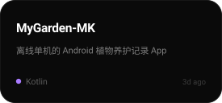
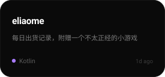
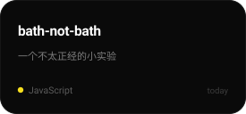
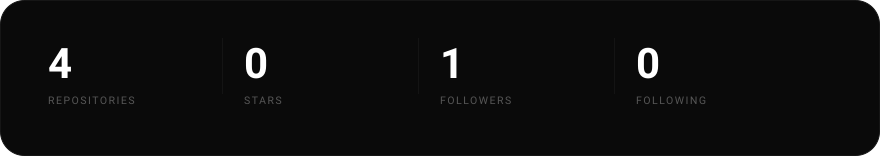
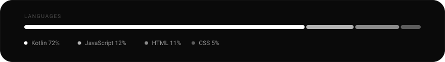

<!--
  M1_998 · GitHub 主页
  视觉语言参考 bencho.dev：纯黑背景 / 白字 / 大字号收紧字距 / 深灰圆角卡片

  用户名 MarkTop1 · 显示名 M1_998

  ── 所有卡片都是本仓库自己生成的，不依赖任何第三方服务 ──
    assets/header.svg      手写的头图
    assets/card-stats.svg  由 scripts/gen_cards.py 生成，每天自动刷新
    assets/card-langs.svg  同上
    assets/card-repo-1.svg 同上（第 1 个精选仓库）
    assets/card-repo-2.svg 同上（第 2 个精选仓库）
    assets/card-repo-3.svg 同上（第 3 个精选仓库）

  想改精选哪几个仓库 → 改 .github/workflows/cards.yml 里的 FEATURED（逗号分隔，最多 6 个）
  想改技术栈 chip   → 删掉对应的那行 
-->

  

  一个人做产品 · 想法 → 设计 → 代码 → 上线 · 全程自己走一遍

  
  
  
  
  
  
  
  

---

<b>SELECTED WORK</b>

  
  
  

---

<b>NUMBERS</b>

  

  

---

<b>CONTRIBUTION SNAKE</b>

<picture>
  <source media="(prefers-color-scheme: dark)" srcset="https://raw.githubusercontent.com/MarkTop1/MarkTop1/output/snake-dark.svg" />
  <source media="(prefers-color-scheme: light)" srcset="https://raw.githubusercontent.com/MarkTop1/MarkTop1/output/snake.svg" />
  
</picture>

每 8 小时自动重跑一次 · powered by Platane/snk

---

<b>ABOUT</b>

  一个人负责产品、设计、开发、上线。 
  不追风口，只把想到的东西做出来。

> "Do It" 不是签名，是工作流。 —— 先做出来，再谈完美。

---

  
  

  © 2026 M1_998 · Built alone, shipped anyway.

